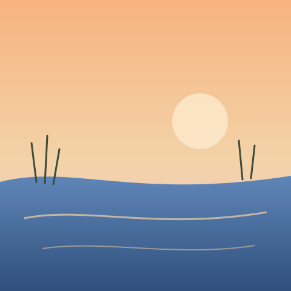

## Summary
Asked for title ideas for a river sketch, then drafted a short poem in two tries. The poem became a canvas with a closing line, and a small cover image was made for it.

## My turns

### Turn 1
~~~text
Here is my sketch of the river. Can you help me title a poem about it?
~~~

### Turn 2
~~~~~text
My draft (second try):
The river folds the evening light
into the pockets of the reeds.
~~~~ (I like tildes)
~~~~~

### Turn 3
~~~text
Add a last line: "and nobody asks it to stay."
~~~

### Turn 4
~~~text
Make a small square cover image for it.
~~~

## AI outputs

### Canvas · River at dusk (last version, 1 edit replayed)
~~~text
# River at dusk

The river folds the evening light
into the pockets of the reeds,
and nobody asks it to stay.
~~~

## Files

### 01 · Cover (turn 4, generated image)

